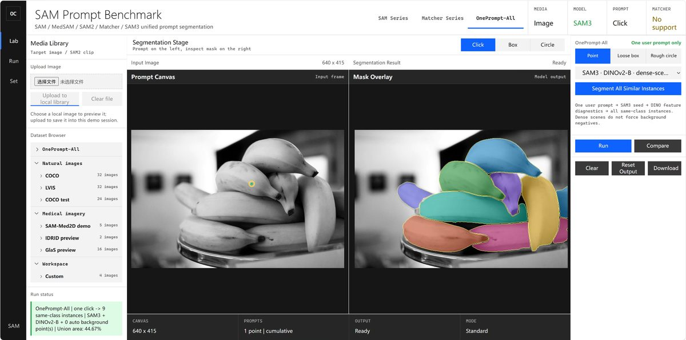
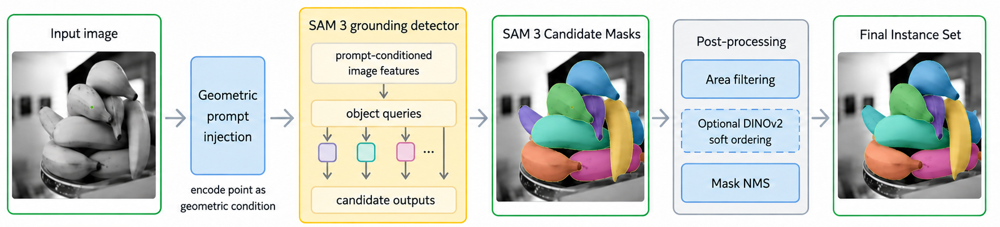

# OnePrompt-All

**One rough prompt, all same-class instances in one image.**

**Language:** [English](README.md) | [中文](README_zh.md)

OnePrompt-All is a training-free framework and interactive workbench for **single-image, single-exemplar, multi-instance segmentation**. From one click, loose box, or rough circle, it returns an independent mask for every matching instance in the same image—without a class name, external reference image, reference mask, or object count.



The unified workbench provides **SAM Series**, **Matcher Series**, and **OnePrompt-All** modes in one browser interface.

## Workbench

Run `surf/demos/medical_sam_click_app.py`, select an image, switch to **OnePrompt-All**, then give exactly one rough prompt:

1. **Click**: click anywhere inside one target instance.
2. **Box**: draw a loose rectangle; it may include background.
3. **Circle**: drag a rough circular region; it may include background.

One gesture triggers one complete inference. Each accepted target is shown as an independent colored mask; no iterative positive/negative clicks are required.

## Setup

The tested configuration is Windows, Python 3.12, CUDA 12.6+, and an NVIDIA GPU. Follow the [official SAM3 installation guide](https://github.com/facebookresearch/sam3#installation) when selecting a PyTorch/CUDA build.

```powershell
conda create -n oneprompt-all python=3.12 -y
conda activate oneprompt-all
pip install torch==2.10.0 torchvision --index-url https://download.pytorch.org/whl/cu128
pip install -r requirements-demo.txt
git clone https://github.com/facebookresearch/sam3.git external/sam3
pip install -e external/sam3
```

### Checkpoints

Weights are intentionally not included. Create this local layout:

```text
assets/
└── checkpoints/
    ├── sam3_modelscope/
    │   └── sam3.pt
    └── dinov2_vitb14_pretrain.pth
```

| Component | Expected file | Source |
|---|---|---|
| SAM3 instance generator | `assets/checkpoints/sam3_modelscope/sam3.pt` | Request access at [SAM3 on Hugging Face](https://huggingface.co/facebook/sam3), run `hf auth login`, then download a compatible image checkpoint. Rename it to `sam3.pt`, or pass `--sam3-checkpoint <path>`. |
| DINOv2-B/14 encoder | `assets/checkpoints/dinov2_vitb14_pretrain.pth` | Download the ViT-B/14 backbone from [official DINOv2 pretrained models](https://github.com/facebookresearch/dinov2#pretrained-models) and save it with this name. |

### Launch

```powershell
python .\surf\demos\medical_sam_click_app.py --host 127.0.0.1 --port 7860
```

Open <http://127.0.0.1:7860>. Reuse an existing service if port 7860 is already occupied. `surf/datasets/oneprompt_all/natural20/` contains 20 small natural-image examples; full datasets, checkpoints, and outputs remain local.

## Method



Given a coarse prompt \(p\) in image \(I\), OnePrompt-All: (1) resolves a SAM3 seed mask; (2) pools DINOv2-B/14 seed tokens into an online exemplar; (3) discovers same-image SAM3 candidates with DINO similarity as soft evidence; (4) selects candidates using SAM confidence, feature consistency, area filtering, and mask NMS; and (5) returns all retained masks independently. Fixed automatic negatives are disabled by default for dense scenes, where apparent background can be another true target.

## Evaluation snapshot

On an integrated benchmark of 2,220 same-image multi-instance images from 232 categories, using five random interior clicks per image:

| Method | Input at inference | F1 | Precision | Recall |
|---|---|---:|---:|---:|
| SAM3 Text Oracle | Correct class name | 0.691 | 0.737 | 0.693 |
| OnePrompt-All | One positive point, no class name | 0.667 | 0.687 | 0.712 |

SAM3 Text Oracle receives the ground-truth class name; OnePrompt-All sees only a point while obtaining comparable F1 and higher recall. See the [method note](surf/research/ONEPROMPT_ALL_METHOD.md) and [evaluation scripts](surf/research/).

## Poster and editable source

- [Download poster PDF](docs/assets/surf_poster.pdf)
- [Editable LaTeX source](poster/main.tex)

The `poster/` directory includes the updated PDF, LaTeX source, and figure dependencies for an Overleaf/pdflatex build.

## References

```bibtex
@misc{onepromptall2026, title={OnePrompt-All: Single-Image Single-Exemplar Multi-Instance Segmentation}, author={OnePrompt-All Authors}, year={2026}, howpublished={\url{https://github.com/DurianLoop/OnePrompt-All}}}
@article{sam3, title={SAM 3: Segment Anything with Concepts}, author={Carion, Nicolas and Gustafson, Laura and Hu, Yuan-Ting and others}, journal={arXiv preprint}, year={2025}}
@article{dinov2, title={DINOv2: Learning Robust Visual Features without Supervision}, author={Oquab, Maxime and Darcet, Timothee and Moutakanni, Theo and others}, journal={Transactions on Machine Learning Research}, year={2024}}
@inproceedings{sam, title={Segment Anything}, author={Kirillov, Alexander and Mintun, Eric and Ravi, Nikhila and others}, booktitle={ICCV}, year={2023}}
@inproceedings{matcher, title={Matcher: Segment Anything with One Shot Using All-Purpose Feature Matching}, author={Liu, Yang and Zhu, Muzhi and Li, Hengtao and others}, booktitle={ICLR}, year={2024}}
```

## Acknowledgements

OnePrompt-All builds on [SAM3](https://github.com/facebookresearch/sam3), [DINOv2](https://github.com/facebookresearch/dinov2), [Segment Anything](https://github.com/facebookresearch/segment-anything), and [Matcher](https://github.com/aim-uofa/Matcher). Please follow their respective licenses and checkpoint-access terms.
