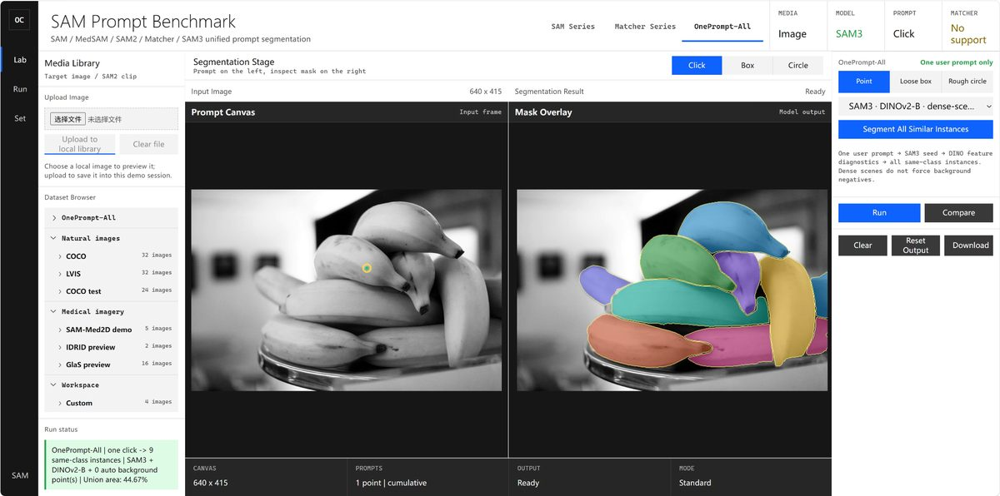
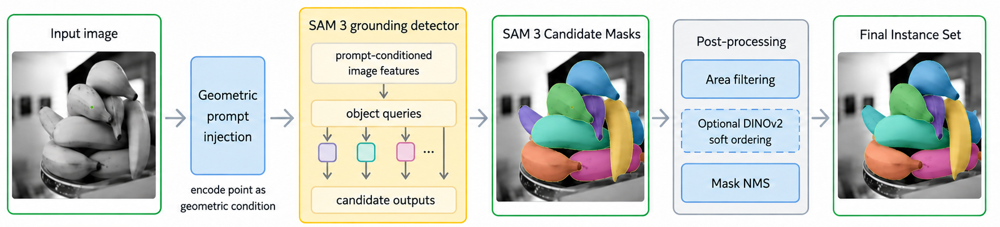

# OnePrompt-All

**一次粗提示，分割单张图中的全部同类实例。**

**语言：** [English](README.md) | [中文](README_zh.md)

OnePrompt-All 是一个面向**单图、单示例、多实例分割**的免训练方法与可交互工作台。用户只需在当前图像中点击一个目标、画一个粗框，或圈出大致区域；系统会在同一张图中理解目标的视觉概念，并输出全部同类实例的独立 mask。推理时不需要类别名称、外部参考图、精确参考 mask 或目标数量。



统一工作台提供 **SAM Series**、**Matcher Series** 和 **OnePrompt-All** 三种模式，可直接比较常规提示分割、跨图参考匹配和同图多实例分割。

## 工作台使用

启动 `surf/demos/medical_sam_click_app.py` 后，选择图像并切换到 **OnePrompt-All**。右上角选择一种一次性粗提示：

1. **Click**：在任意一个目标实例内部点击一点；
2. **Box**：画一个粗略矩形框，允许包含背景；
3. **Circle**：拖动圈出大致圆形区域，允许包含背景。

一次操作只触发一次完整推理。结果面板以不同颜色显示每个保留实例的独立 mask，不要求连续添加正点或负点。

## 环境配置

推荐环境为 Windows、Python 3.12、CUDA 12.6+ 与 NVIDIA GPU。PyTorch/CUDA 版本请以官方 [SAM3 安装说明](https://github.com/facebookresearch/sam3#installation)为准。

```powershell
conda create -n oneprompt-all python=3.12 -y
conda activate oneprompt-all
pip install torch==2.10.0 torchvision --index-url https://download.pytorch.org/whl/cu128
pip install -r requirements-demo.txt
git clone https://github.com/facebookresearch/sam3.git external/sam3
pip install -e external/sam3
```

### 模型权重

模型权重的下载、放置、验证以及 SAM3、DINOv2、SAM、SAM2、MedSAM、Matcher 的可选配置，均见独立的[模型权重说明](docs/MODEL_WEIGHTS.md)。

### 启动

```powershell
python .\surf\demos\medical_sam_click_app.py --host 127.0.0.1 --port 7860
```

浏览器访问 <http://127.0.0.1:7860>。若 7860 端口已有服务，请直接复用，不要重复启动。`surf/datasets/oneprompt_all/natural20/` 内含 20 张自然图示例；完整数据集、权重和运行结果不纳入 Git。

## 方法



给定图像 \(I\) 中的粗提示 \(p\)，方法先由 SAM3 得到 seed mask，再汇聚 seed 内的 DINOv2-B/14 token 构造在线 exemplar；随后发现同图 SAM3 实例候选。DINO 相似度仅作为软证据，结合 SAM 置信度、特征一致性、最小面积过滤和 mask NMS 来选择候选集合，最终一次性独立输出全部保留实例 mask。密集场景默认不使用固定自动背景负点，因为看似背景的区域可能属于另一真实目标。

## 评测摘要

在整合的 2,220 张、232 类同图多实例 benchmark 上，每图随机采样 5 个实例内部点击：

| 方法 | 推理时输入 | F1 | Precision | Recall |
|---|---|---:|---:|---:|
| SAM3 Text Oracle | 正确类别名称 | 0.691 | 0.737 | 0.693 |
| OnePrompt-All | 单个正点，无类别名称 | 0.667 | 0.687 | 0.712 |

Text Oracle 预先获得 GT 类别名；OnePrompt-All 只有一个点提示，但获得相近 F1 和更高 Recall。具体协议见[方法说明](surf/research/ONEPROMPT_ALL_METHOD.md)和[评测脚本](surf/research/)。

## 海报与可编辑源文件

- [下载海报 PDF](docs/assets/surf_poster.pdf)
- [可编辑 LaTeX 源文件](poster/main.tex)

`poster/` 目录包含更新后的 PDF、LaTeX 源文件和全部依赖图片；上传到空白 Overleaf 项目后使用 pdfLaTeX 即可编译编辑。

## 参考文献

[外部依赖与参考文献](docs/EXTERNAL_DEPENDENCIES_zh.md)提供规范 BibTeX、软件来源与数据集引用。项目尚无预印本或 DOI，因此刻意不提供 OnePrompt-All 的自引占位条目。

## 致谢

OnePrompt-All 基于 [SAM3](https://github.com/facebookresearch/sam3)、[DINOv2](https://github.com/facebookresearch/dinov2)、[Segment Anything](https://github.com/facebookresearch/segment-anything) 和 [Matcher](https://github.com/aim-uofa/Matcher) 构建。请遵守各项目对应的许可证与权重访问条款。
