# Phase Y Final Report — Fresh-Query Confirmation, Oracle Stability, and Deployable Policy Feasibility

Date: 2026-07-21T23:11:05

## Executive Summary

- **Final state**: `PHASEY_SEARCH_ORACLE_DIAGNOSTIC_ONLY`
- **Splits**: train=80 / validation=41 / holdout=40
- **Strongest fixed**: `Y_P_TOPK_K50_N0_N_NONE_G1_C1` (Dice=0.4338)
- **Stable oracle**: 0.4399 (gap=0.0061)
- **Bank Policy validation**: best model `N/A` (Dice=N/A, Δ=N/A, recovery=0.000)
- **Bank Policy holdout**: Dice=N/A, Δ=N/A, decision=`NOT_RUN`
- **Formal test allowed**: see Q20 (Phase Z freeze required)

## Section 22: 22 Mandatory Questions

### Q1. Fresh query count?

train=80, validation=41, holdout=40 (eligible fresh cases: 161)

### Q2. Are historical 10 queries excluded from primary statistics?

Yes — historical 10 Phase X queries are listed in split_summary.phasex_query_cases and excluded from Phase Y train/validation/holdout primary statistics (used only for method discovery / historical appendix per section 4.2).

### Q3. Are Reference Sets A/B independent?

Patient-level disjoint: True; A/B disjoint per query: True; reference patient ≠ query patient: True. Set A rows: 483, Set B rows: 483.

### Q4. Raw oracle gap?

Raw Oracle-A = 0.5007, Fixed-A = 0.4338, raw oracle gap = 0.0669.

### Q5. Cross-reference stable oracle gap?

Stable oracle = 0.4399, stable oracle gap = 0.0061.

### Q6. Oracle optimism?

Optimism-A = 0.0749 (ratio = 1.120 of raw gap); Optimism-B = 0.0297.

### Q7. Is best action stable across references?

Exact action agreement rate = 0.0488; K+ bin agreement (±5) = 0.3902; selector agreement = 1.0000; median Spearman ρ = 0.7450; mean top-3 overlap = 0.0894.

### Q8. Does 91-action heterogeneity replicate on fresh queries?

Gate Y1 decision: `PHASEY_GATE_Y1_ORACLE_GAP_SMALL`. Action count evaluated: 210. Diff-from-fixed rate: 0.0000. Stable oracle gap ≥ 0.015: False.

### Q9. How was compact bank derived (train-only)?

Compact bank derived train-only via Pareto pruning (section 7.2): drop dominated actions in Dice/calls/runtime; drop actions clearly inferior across train folds; within a family keep simpler action when Dice diff < 0.003; validation and holdout did NOT participate. Compact bank status: PLACEHOLDER_PENDING_PARETO_PRUNING; Pareto pruning report: missing.

### Q10. Strongest fixed exact config?

Strongest fixed action: `Y_P_TOPK_K50_N0_N_NONE_G1_C1` (mean Dice on A = 0.4338). Config: single SAM call, G_ONE_GROUP.

### Q11. Bank policy validation improvement?

Best model: `N/A` (mean Dice = N/A, Δ vs fixed = N/A, oracle recovery = 0.000). Gate Y3 decision: `NOT_RUN`.

### Q12. Holdout improvement?

Holdout mean policy Dice = N/A, mean fixed Dice = N/A, Δ = N/A (CI [N/A, N/A]). Decision: `NOT_RUN`.

### Q13. Oracle recovery %?

Bank policy validation oracle recovery = 0.000; holdout oracle recovery ≈ 0.0%.

### Q14. 3 seeds consistent?

Y3 cond4 (3 seeds direction consistent) = N/A. Seed-stability std (table 17): see table_17_seed_stability.

### Q15. Does policy collapse to global action?

Non-modal rate = N/A; winning action classes = N/A. cond7 (not global action) = N/A.

### Q16. Search Oracle cross-reference gap?

Raw search Dice = 0.5947, cross-reference search Dice = 0.4105, cross gap = 0.1843, search optimism = 0.1843. Gate Y2 decision: `PHASEY_GATE_Y2_SEARCH_ORACLE_OVERFIT`.

### Q17. Are search labels suitable for supervision?

Optimism ratio = 1.145; median |K_A - K_B| = 6.00; mean point overlap (Jaccard) = 0.3322; beat-fixed rate on B = 0.2683. Decision: `PHASEY_GATE_Y2_SEARCH_ORACLE_OVERFIT`.

### Q18. Does Point-Subset beat Bank Policy?

Gate Y4 decision: `NOT_RUN`. Point-Subset val Dice = 0.0000 vs Bank Policy val Dice = 0.0000. Δ = 0.0000.

### Q19. Do all methods use same SAM calls?

Yes — all deployable methods (fixed, bank policy, point-subset) use exactly 1 SAM call and 1 prompt group (G_ONE_GROUP) per section 6. Search Oracle uses ~558 search SAM calls but only 1 deployed call (privileged, not deployable).

### Q20. Is formal test allowed?

Formal test NOT yet auto-allowed. Holdout pass = False. Per section 20, even after holdout pass, Phase Z freeze (docs/phaseZ_formal_test_freeze.md, configs/frozen/monusac_final_policy.yaml, reports/phaseZ_test_hashes.json, reports/phaseZ_statistical_plan.md, reports/phaseZ_qualitative_sampling_plan.md) must be created and user approval obtained before any MoNuSAC formal test access.

### Q21. Final scientific state?

PHASEY_SEARCH_ORACLE_DIAGNOSTIC_ONLY

### Q22. Which claims are still not allowed?

Permanently forbidden claims (section 21): Search Oracle is deployable; 0.7256 is policy performance; 91-action Oracle proves policy success; matched deployed calls make GT search a fair automatic baseline; 10 episodes are sufficient for final statistical evidence; reference episodes are independent samples.

## Tables (Section 15)

- [Table 1: Fresh Data Split](phaseY_final_report/tables/01_fresh_data_split.md)
- [Table 2: Prior Exposure Audit](phaseY_final_report/tables/02_prior_exposure_audit.md)
- [Table 3: Full Single-Call Action Bank (210 actions)](phaseY_final_report/tables/03_full_single_call_action_bank.md)
- [Table 4: Compact Policy Bank (12-32 actions)](phaseY_final_report/tables/04_compact_policy_bank.md)
- [Table 5: Fixed Action Absolute Performance](phaseY_final_report/tables/05_fixed_action_absolute_performance.md)
- [Table 6: Raw / Cross-Reference / Stable Oracle](phaseY_final_report/tables/06_raw_cross_stable_oracle.md)
- [Table 7: Oracle Optimism (per query)](phaseY_final_report/tables/07_oracle_optimism.md)
- [Table 8: Action Stability](phaseY_final_report/tables/08_action_stability.md)
- [Table 9: Reference Sensitivity](phaseY_final_report/tables/09_reference_sensitivity.md)
- [Table 10: Bank-Policy Validation (M0-M5)](phaseY_final_report/tables/10_bank_policy_validation.md)
- [Table 11: Bank-Policy Holdout](phaseY_final_report/tables/11_bank_policy_holdout.md)
- [Table 12: Point-Subset Validation (if Y4 ran)](phaseY_final_report/tables/12_point_subset_validation.md)
- [Table 13: Point-Subset Holdout (if Y4 ran)](phaseY_final_report/tables/13_point_subset_holdout.md)
- [Table 14: Oracle Recovery](phaseY_final_report/tables/14_oracle_recovery.md)
- [Table 15: Calls / Runtime / GPU Hours](phaseY_final_report/tables/15_calls_runtime.md)
- [Table 16: Failure Taxonomy](phaseY_final_report/tables/16_failure_taxonomy.md)
- [Table 17: Seed Stability](phaseY_final_report/tables/17_seed_stability.md)
- [Table 18: Final Gate Decision](phaseY_final_report/tables/18_final_gate_decision.md)

## Figures (Section 16)

- 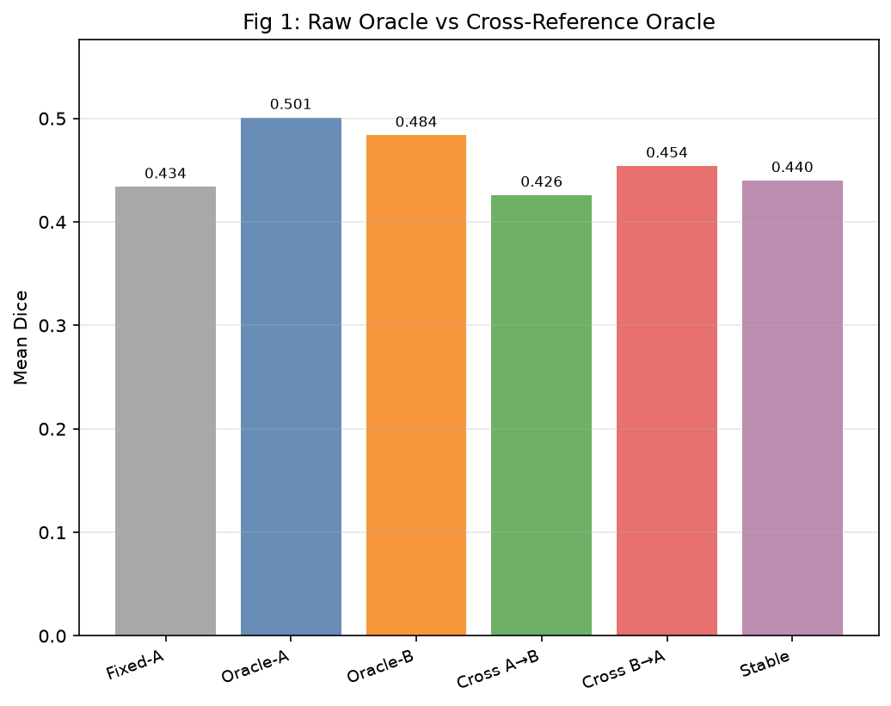
- 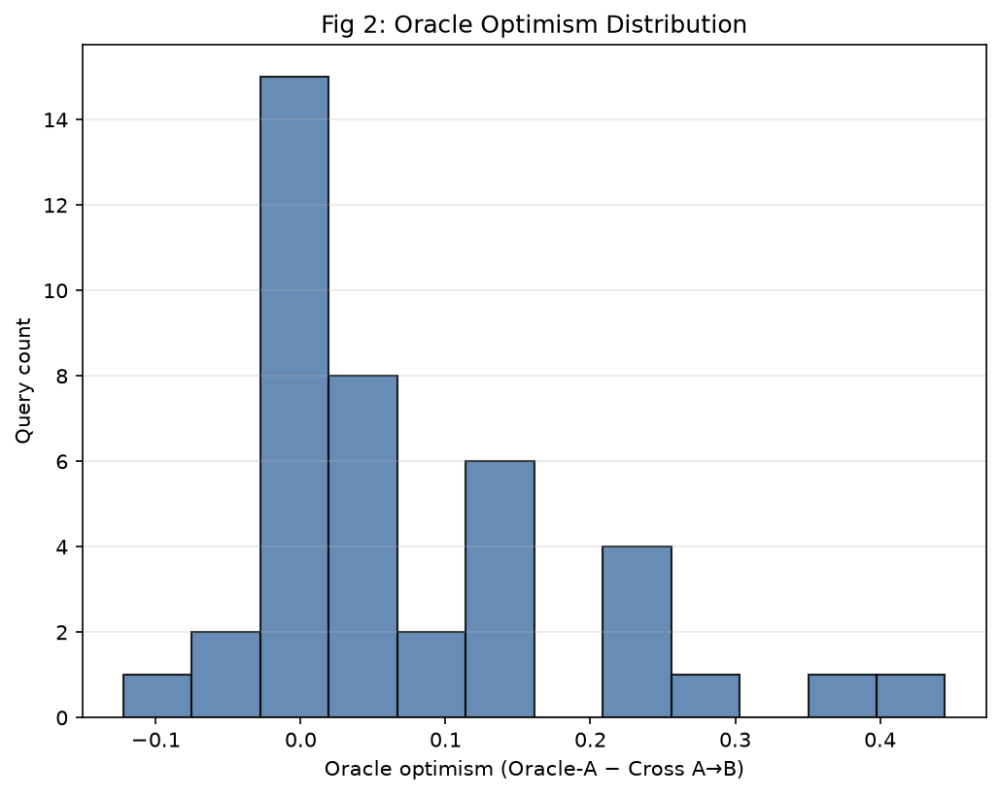
- 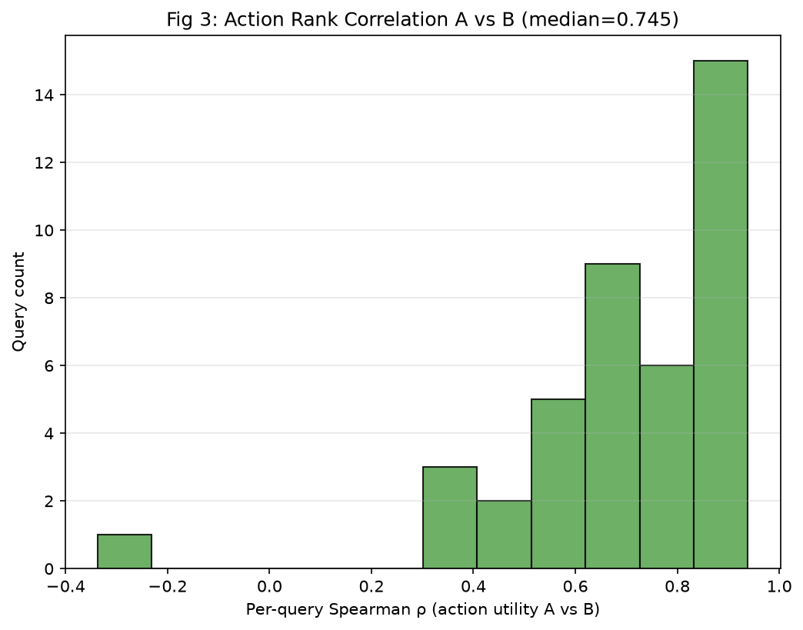
- 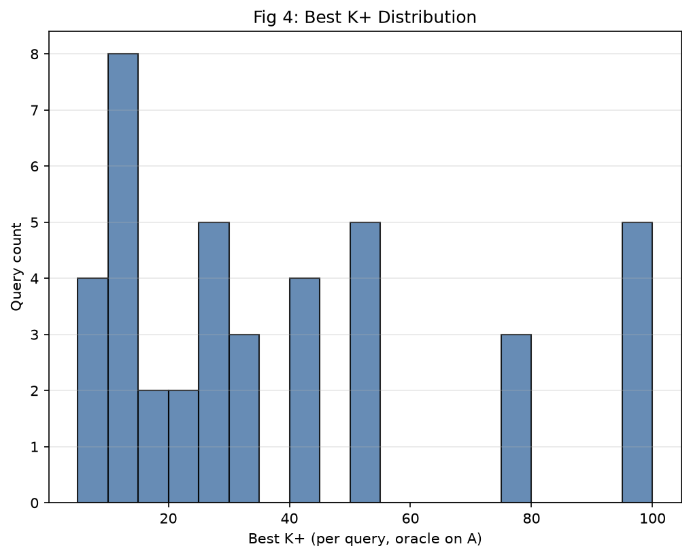
- 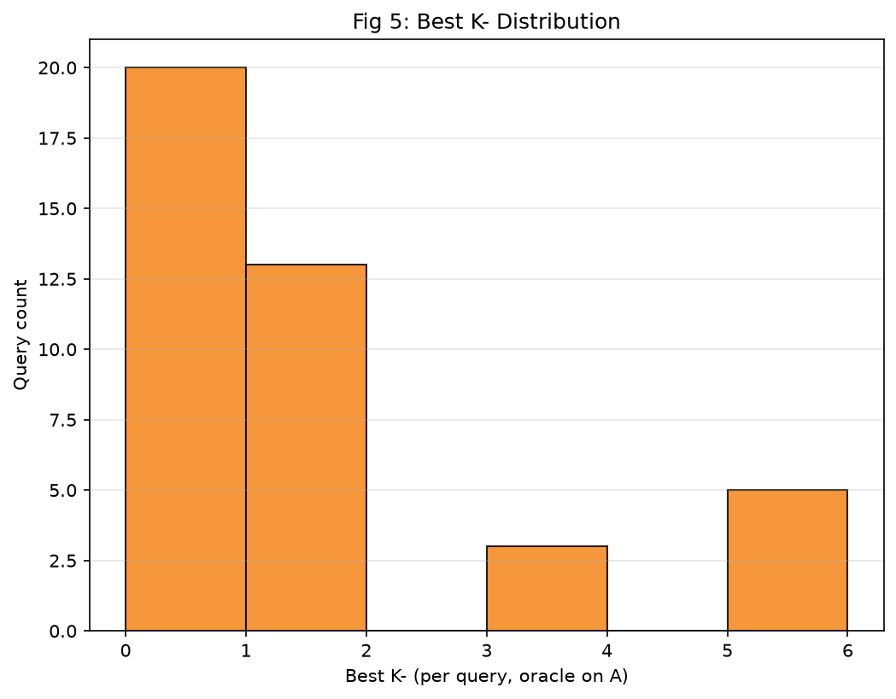
- 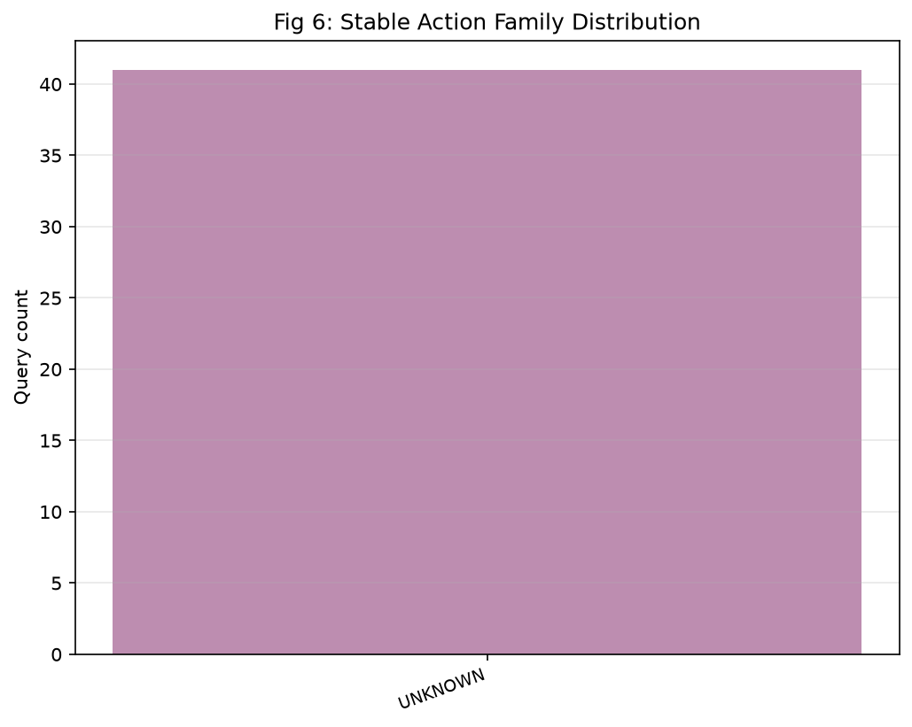
- 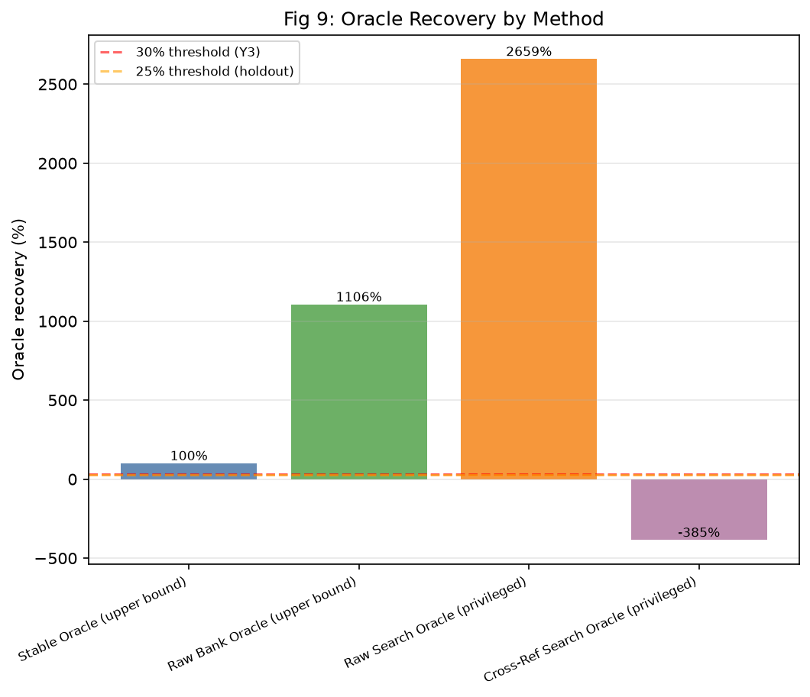
- 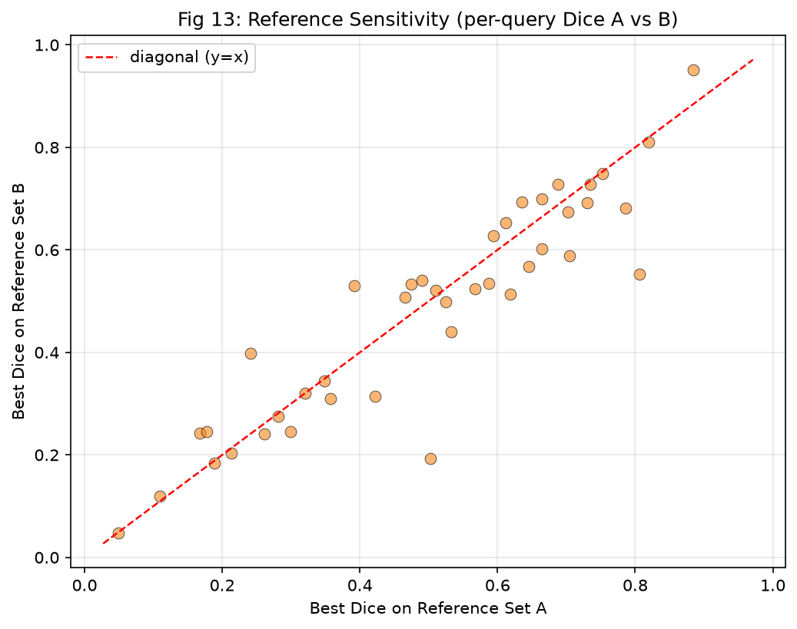
- 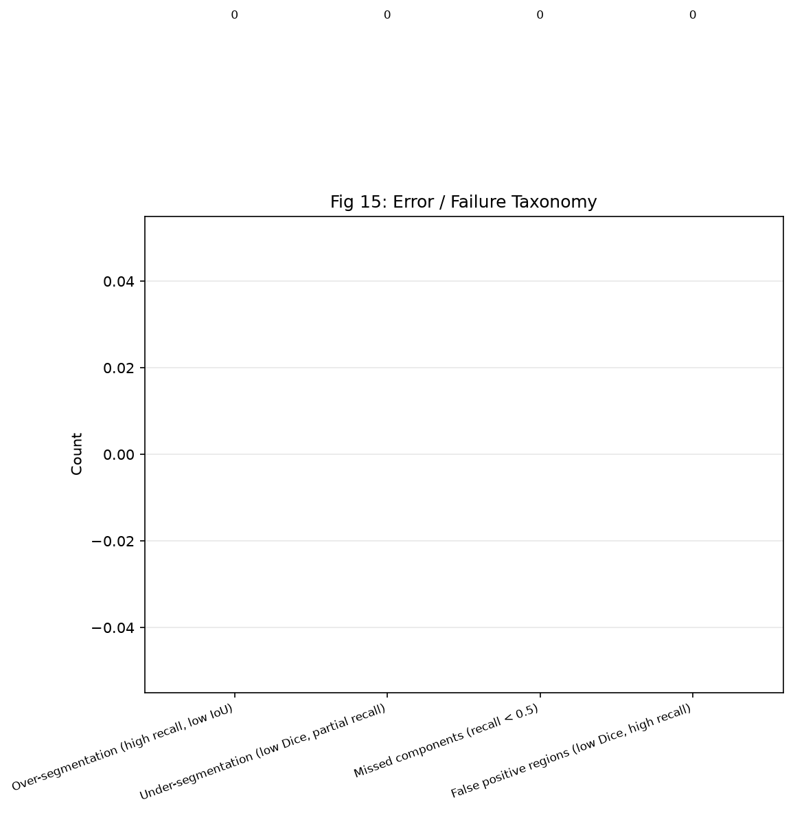
- 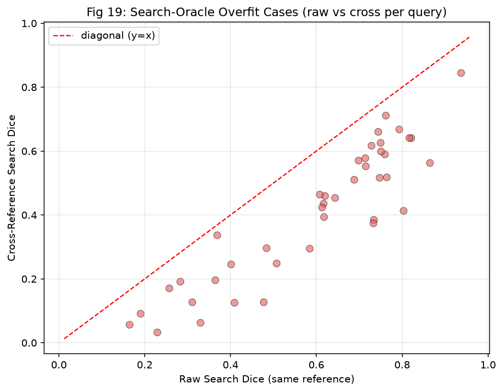
- 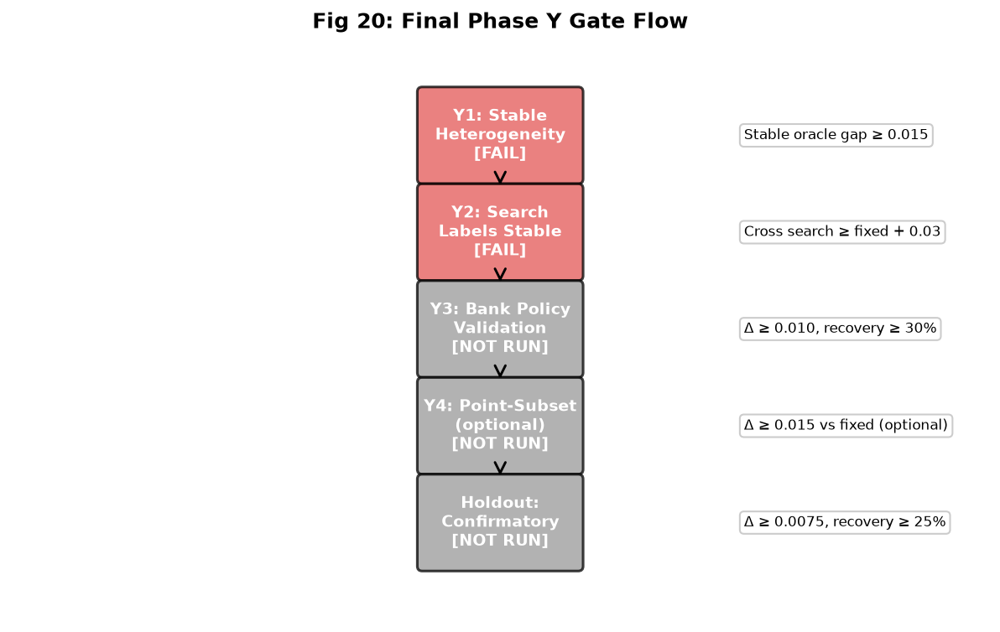

### Skipped figures

- `fig_07_fixed_vs_bank_policy_paired_scatter.png` — builder produced no file (missing data)
- `fig_08_fixed_vs_point_subset_paired_scatter.png` — builder produced no file (missing data)
- `fig_10_dice_vs_estimated_target_count.png` — builder produced no file (missing data)
- `fig_11_dice_vs_map_entropy.png` — builder produced no file (missing data)
- `fig_12_policy_action_vs_candidate_dispersion.png` — builder produced no file (missing data)
- `fig_14_calibration_plot.png` — builder produced no file (missing data)
- `fig_16_qualitative_fixed_win_cases.png` — builder produced no file (missing data)
- `fig_17_qualitative_policy_win_cases.png` — builder produced no file (missing data)
- `fig_18_high_confidence_policy_failures.png` — builder produced no file (missing data)

## Reproducibility

All inputs are frozen Phase Y artifacts under `reports/phaseY_*/`, `configs/actions/`, `configs/frozen/`, `manifests/phaseY/`, and `docs/`. The script `scripts/build_phaseY_final_report.py` regenerates this report deterministically; no SAM inference is performed.

